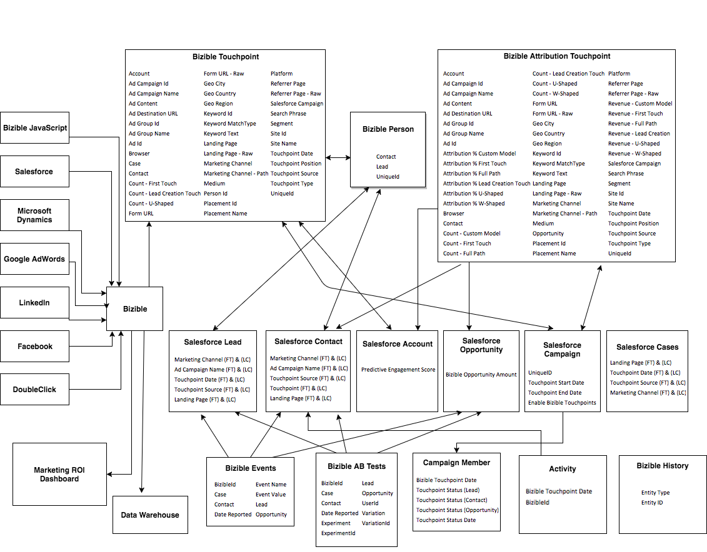

# 隱藏不必要的報表型別 {#hiding-unnecessary-report-types}

完成安裝並開始使用報表後，組織不會使用[!DNL Marketo Measure]套件隨附的每個報表。 因此，隱藏您未使用的報表型別會很有幫助，這樣可以避免任何混淆，並讓外觀更乾淨。 您可以隱藏任何想要的報表，但下圖中所識別的報表通常是隱藏的。

1. 導覽至&#x200B;**[!UICONTROL Reports]**&#x200B;標籤。

1. 按一下熒幕上方的&#x200B;**[!UICONTROL Create New Report]**&#x200B;按鈕。

1. 輸入「接觸點」一詞以填入報表。

1. 選取左上方的&#x200B;**[!UICONTROL Select Report Types to Hide]**&#x200B;核取方塊。

1. 按一下以下標示為橘色X的報告，讓您的報告清單看起來與下方影像相同。

   

>[!MORELIKETHIS]
>
>[Salesforce — 隱藏未使用的報表型別](https://help.salesforce.com/articleView?id=release-notes.rn_analytics_hide_report_types.htm&type=5&language=en_us)
