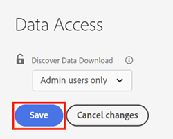

# [!UICONTROL Discover Data Download]存取控制 {#discover-data-download-access-control}

[!UICONTROL Discover Data Download]控制項可讓[!DNL Marketo Measure]管理員根據使用者的角色，設定Discover儀表板的資料下載原則。 控制項涵蓋Discover控制面板上的所有資料下載動作。

1. 按一下[!UICONTROL Security]下的&#x200B;**[!UICONTROL Data Access]**。

   

1. 按一下下拉式清單，然後為您的主控台選取適當的選項。

   

| 選項 | 下載存取權 |
| --- | --- |
| 所有使用者 | 所有使用者都可以下載資料，包括PDF和CSV格式。 |
| 僅限管理員使用者 | 只有管理員使用者可以下載資料，包括PDF和CSV格式。 |
| None | 沒有人可以下載資料，包括PDF和CSV格式。 |

1. 完成後請按一下 **[!UICONTROL Save]**。

   

此設定可能要在使用者登出再重新登入後才會生效。
